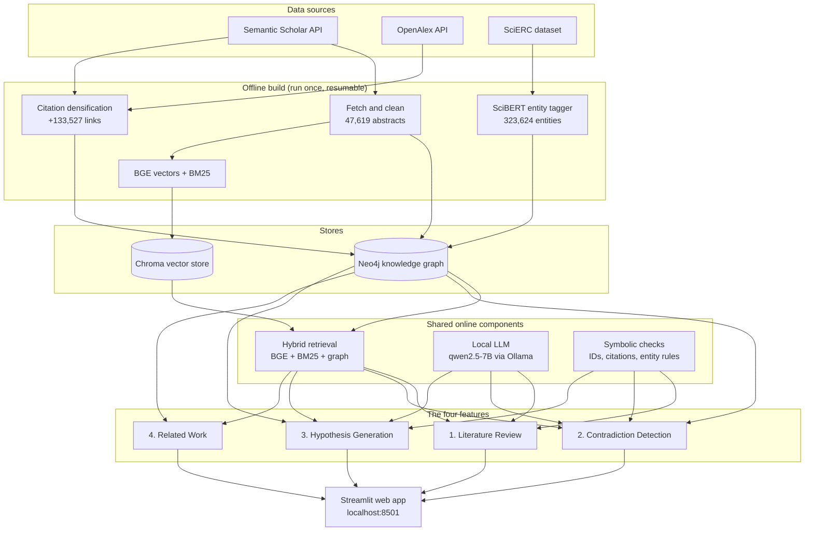
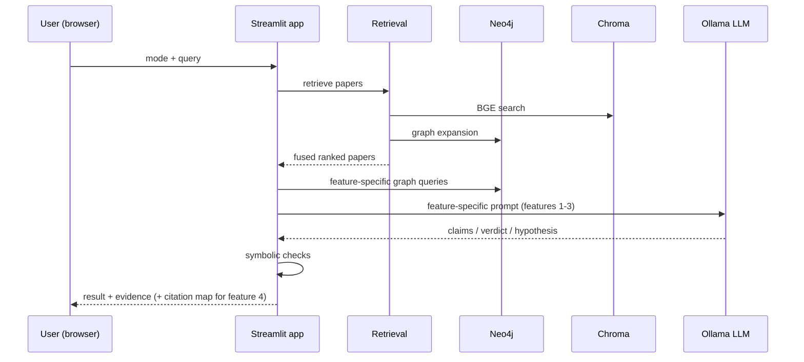

# NeSy-GraphRAG: System Overview (start here)

**Read this first.** It explains the whole project: what it is for, the data, the parts every feature shares, and how the four features fit together. Then read the file for the feature you work on:

1. [01_LITERATURE_REVIEW.md](01_LITERATURE_REVIEW.md): cited summary of a research question
2. [02_CONTRADICTION_DETECTION.md](02_CONTRADICTION_DETECTION.md): papers that dispute papers they cite
3. [03_HYPOTHESIS_GENERATION.md](03_HYPOTHESIS_GENERATION.md): untried method → task combinations
4. [04_RELATED_WORK.md](04_RELATED_WORK.md): papers to cite for a draft, with a citation map

Everyone should be able to explain Sections 1–6 of this page; each person should know their own feature file in depth.

---

## 1. What the project is

**Project title:** Automating Review and Hypothesis Generation (code name **NeSy-GraphRAG**).

**Problem:** researchers have too many papers to read, and LLM assistants write fluent text with citations nobody can check.

**What we built:** a research assistant over **47,619 computer-science abstracts** (Semantic Scholar, 2020–2025, 11 topics) that runs on one laptop with a local LLM, and that **shows the evidence behind every output**.

**What we found:** a careful, task-by-task evaluation of *where a knowledge graph actually helps*. It helps a lot for citation-related tasks and research discovery, and adds little for plain topic search, where text retrieval is already strong.

**In one sentence:** neural models (embeddings, an LLM, NLI) propose; a knowledge graph and explicit rules (citations, entity types, ID checks) restrict and verify what is shown. That combination is what "neuro-symbolic" (NeSy) means here.

---

## 2. The big picture



There are three layers to keep in mind:

1. **Offline build:** turns raw papers into two stores. You rarely touch this.
2. **Shared online components:** retrieval, the LLM client, the symbolic checks. Every feature uses some of them.
3. **Features:** four pipelines, each with its own logic on top of the shared parts.

---

## 3. The data (shared by everyone)

### 3.1 Corpus

- **47,619 papers**, titles and abstracts only (no PDFs), years 2020–2025.
- **11 topics:** graph neural networks; AI and machine learning; cybersecurity; computer networks; databases; software engineering; cloud computing; natural language processing; computer vision; data science; operating systems.
- Each paper is cleaned, de-duplicated, and must have an abstract of at least 30 words.

### 3.2 Knowledge graph (Neo4j)

| Node | Count | What it is |
|---|---:|---|
| `Paper` | 47,619 | id, title, abstract, year, venue |
| `SciEntity` | 323,624 | scientific entity: name, type (Method, Task, Material, Metric, Other), document frequency, generic flag |
| `Author` | — | linked by `AUTHORED_BY` |
| `ExternalPaper` | 24,714 | papers outside the corpus cited by at least 10 corpus papers |
| `Concept` | — | old spaCy noun phrases from Phase 2; kept but unused |

| Edge | Count | Meaning | Used by |
|---|---:|---|---|
| `CITES` | 22,370 | original citations | retrieval, contradiction, related work |
| `CITES_ADDED` | 133,527 | citations added by densification | contradiction, related work, hypothesis |
| `COUPLED_WITH` | 411,418 | two papers citing the same works (bibliographic coupling) | evaluation only |
| `SIMILAR_TO` | 238,095 | 5 nearest neighbours by embedding | retrieval |
| `MENTIONS` | 696,390 | paper → entity (first 15 per abstract) | contradiction, hypothesis |
| `CITES_EXTERNAL` | 641,616 | paper → external paper | coverage only |

**Why densification mattered:** at first only 23% of papers had reference lists (Semantic Scholar hides many for licensing reasons), and 71% of papers had no citation link at all. We fetched reference lists from the Semantic Scholar batch API and from OpenAlex by DOI. Now only 13% have no citation link. The contradiction and related-work features would barely work without this.

### 3.3 Scientific entities

We fine-tuned **SciBERT on the SciERC dataset**, the only model we trained (typed F1 **0.639**, close to published results; zero-shot GLiNER scored 0.240). It tags spans in every abstract as Method, Task, Material, Metric or OtherScientificTerm, giving 1.2 million mentions. Entities in more than 1% of papers, or generic heads like "method", are flagged **generic** and ignored by the reasoning features.

### 3.4 Vector store (Chroma)

Every paper is embedded once with **BGE (`BAAI/bge-base-en-v1.5`)** as "title. abstract" in the collection `s2_papers_bge`. Queries get BGE's instruction prefix.

---

## 4. Shared components (every feature builds on these)

### 4.1 Hybrid retrieval: `src/pipeline/retrieval.py` → `nesy_retrieve`

Used by features 1, 2 and 3 (feature 4 has its own variant).

1. **BGE** dense search: top 10 by cosine similarity.
2. **BM25** keyword search: catches exact technical terms.
3. **Graph expansion**: follow `CITES` and `SIMILAR_TO` from the dense results (up to 2 hops, at most 50 candidates), keeping only neighbours whose similarity is within 0.03 of the weakest dense result (the *relative gate*).
4. **Reciprocal rank fusion (RRF)** of the three lists, using only ranks so the different score scales don't matter ($k = 60$, equal weights).
5. **Collapse near-duplicates** (preprint vs published versions).

Full details and formulas: [01_LITERATURE_REVIEW.md](01_LITERATURE_REVIEW.md), Steps 1–5.

### 4.2 Local LLM: `src/utils/llm_client.py`

- `qwen2.5:7b-instruct` served by **Ollama** on `127.0.0.1:11434`, temperature 0 (deterministic), kept loaded for 30 minutes.
- The model uses about 5 GB: about 3 GB on the 4 GB GPU and about 2 GB of RAM. On a 16 GB laptop, close other heavy apps first.
- Larger models (Qwen3.8-27B, GPT-OSS-120B) were used **only for evaluation**, through the Groq API.
- Every prompt tells the model to treat paper text as data and ignore instructions inside it.

### 4.3 Symbolic checks

| Check | Where | Feature |
|---|---|---|
| Paper IDs must exist in Neo4j | `validator.py` | 1 |
| Every claim must cite passage IDs that exist | `provenance.py` | 1 |
| Candidate pairs must be linked by a citation | `contradiction_citation.py` | 2 |
| Both sentences must name the same specific entity | `contradiction_citation.py` | 2 |
| Verdict must be CONTRADICTION with confidence ≥ 0.70 | `contradiction.py` | 2 |
| Method and task must never co-occur; generic entities excluded | `hypothesis_ranker.py` | 3 |
| Suggestions come from neighbours' real reference lists | `related_work.py` | 4 |

### 4.4 Shared building blocks

- **Passage IDs** (`provenance.py`): every abstract sentence gets a stable ID `P<hash>-S<nnn>`. Features 1 and 2 use them to point at exact sentences.
- **NLI model** (`cross-encoder/nli-deberta-v3-small`): scores entailment and contradiction between two sentences. Feature 2 uses it to rank candidates; feature 1 uses it for the optional support check.
- **RRF**: used in retrieval, in feature 3 (to fuse three scores) and in feature 4 (to fuse three lists).

---

## 5. How the four features fit together

| | 1. Literature Review | 2. Contradiction Detection | 3. Hypothesis Generation | 4. Related Work |
|---|---|---|---|---|
| **User gives** | a research question | a topic | a topic or task | a draft title and abstract |
| **User gets** | cited summary; withheld claims | sentence pairs that conflict, with a verdict | method → task ideas with evidence | papers to cite, reasons, citation map |
| **Retrieval** | hybrid (top 10) | hybrid (top 50) | BGE seeds (top 5) | BGE neighbours (50) + BM25 |
| **Graph part used** | `CITES`, `SIMILAR_TO` expansion; ID checks | `CITES`, `CITES_ADDED`; `MENTIONS` | entity co-occurrence; citation links | `CITES`, `CITES_ADDED` of neighbours |
| **LLM role** | writes claims with citations | judges each pair (JSON verdict) | writes up a ranked pair | none |
| **Main formula** | RRF; provenance rule | symmetric NLI score | Adamic–Adar + vector + citation, fused by RRF | co-citation score + RRF |
| **Precomputed** | no | yes, corpus-wide index (591 pairs) | yes, matrices (built on first query) | no |
| **Code entry point** | `review.py: llm_review` | `contradiction.py: llm_contradict` | `hypothesis.py: llm_hypothesis` | `related_work.py: related_work` |

**The common thread:** every feature turns graph structure into **evidence a person can check**: passage IDs (1), a citation link and two sentences (2), bridging concepts and an example paper (3), the similar papers that cite each suggestion (4).

### What happens when you press "Run"



---

## 6. Results in one table (where the graph helps)

Every number is in [docs/RESULTS.md](../RESULTS.md) with its source file. `python -m src.evaluation.reproduce` checks 35 headline numbers (27 recomputed from raw files).

| Feature / task | Result | Role of the graph |
|---|---|---|
| Topical retrieval (feeds 1, 2, 3), 44 queries | NDCG@10 **0.644**; BGE + BM25 alone 0.621; graph adds +0.023 (not significant); a cross-encoder reranker gives a similar gain (0.651; both 0.668); LightRAG-style baseline 0.396 | Redundant for ranking; provides ID checks |
| **4. Related work**, 400 test papers | Recall@20 **0.308** vs 0.241 for text (**+28%**, p < 0.0001); also helps SPECTER2 and SciNCL on DBLP | Main source of the gain |
| **3. Hypothesis**, time-sliced (predict 2023–25 from ≤ 2022) | AP **0.083** vs 0.044 for text only (p < 0.0001) | Main predictive signal |
| **2. Contradiction**, human-labelled | contradiction-or-tension precision **56%** (5/9) vs 9% for the old screener (p = 0.003) | Makes the feature work (small sample) |
| **1. Review**, answer grounding | 99.6% valid citations; 41.8% of claims entailed by their cited sentence (vector RAG 38.9%, n.s.) | Traceability, not correctness |

**How the evaluation was made trustworthy:**
- Development and test splits were frozen, and every setting was chosen on development data first.
- Relevance labels come from an LLM judge validated against human grades: κ 0.75 on GNN-topic pairs, 0.57 on the other topics (strict), while a 27B judge reached 0.88.
- Three anonymous human raters were used (Rater A built the system).
- Significance was tested with paired tests, bootstrap confidence intervals and Holm correction.
- Negative results are reported, not hidden.

---

## 7. Repository map (where things live)

```text
app/                 Streamlit app (streamlit_app.py) and citation map (graph_view.py, static/)
src/ingestion/       download, cleaning, densification, SciERC tagger and its training
src/storage/         Chroma index, Neo4j loader, entity and similarity layers
src/pipeline/        retrieval + the four features + provenance and verdict checks
src/evaluation/      benchmarks, baselines, judge validation, statistics, reproduce.py
src/utils/           config (reads .env), LLM client
evaluation/          benchmark queries, human rating sheets and scorers
results/             saved rankings, labels and summaries behind every number
docs/                run guide, results, paper draft, protocol, demo queries, these feature files
tests/               416 unit tests (no database or model needed)
reports/             Phase 3 report (phase3report.docx)
```

---

## 8. Running it

Full guide: [docs/RUN_FROM_SCRATCH.md](../RUN_FROM_SCRATCH.md). Short version once the data is built:

1. Start **Neo4j** (Neo4j Desktop → start the `NeSy-Graph` DBMS).
2. Start **Ollama** (`ollama serve`); the model `qwen2.5:7b-instruct` must be pulled.
3. Run the app:
   ```powershell
   .\venv\Scripts\python.exe -m streamlit run app\streamlit_app.py --server.address localhost
   ```
4. Open http://localhost:8501, pick a mode, and enter a query (examples in [docs/DEMO_QUERIES.md](../DEMO_QUERIES.md)).

Checks: `python -m pytest -q` (416 tests) and `python -m src.evaluation.reproduce` (35 numbers).

**Safety rules:** keep `NEO4J_ALLOW_RESET=false`, keep secrets only in `.env` (never commit it), and never delete data to restart a stage; all stages resume.

---

## 9. Glossary

| Term | Meaning |
|---|---|
| RAG / GraphRAG | retrieval-augmented generation; the graph version adds a knowledge graph |
| BGE | the general-purpose text embedding model we use |
| BM25 | classic keyword ranking function |
| RRF | reciprocal rank fusion: combine ranked lists using $1/(k + \text{rank})$ |
| NLI | natural language inference: does sentence A entail, contradict, or neither, sentence B |
| SciERC | dataset of CS abstracts annotated with scientific entities; used to train our tagger |
| Co-citation | here: papers cited by the query's nearest neighbours |
| Adamic–Adar | link score that weights shared neighbours by $1/\log(\text{degree})$ |
| NDCG@10, Recall@20, AP, MRR | ranking quality metrics (defined in the feature files) |
| κ (kappa) | agreement between two raters corrected for chance |
| Densification | adding missing citation links from external sources |
| Provenance | the trace from a claim back to its source sentence |

---

## 10. Suggested reading order

1. This page, all of it (about 15 minutes).
2. Your own feature file, in depth.
3. A skim of the other three feature files: the "pipeline at a glance" diagram, the step headings and the results table.
4. For the evaluation story: [docs/RESULTS.md](../RESULTS.md); for the paper: [docs/PAPER_DRAFT.md](../PAPER_DRAFT.md).
