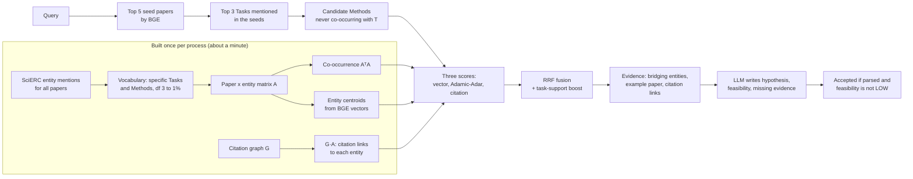

# Feature 3: Hypothesis Generation (method–task ranker)

> New to the project? Read [00_SYSTEM_OVERVIEW.md](00_SYSTEM_OVERVIEW.md) first. It explains the data, the shared components and how this feature fits with the other three.

**What it does:** for a research topic, proposes untried combinations of the form **"apply method M to task T"**: pairs that never appear together in any paper of the corpus, ranked by how strongly the literature connects them. Each suggestion comes with its evidence (linking concepts, citation links, an example paper) and an LLM-written hypothesis with feasibility and what still needs testing.

**Key idea (literature-based discovery):** if a method and a task are both linked to the same specific concepts, their papers cite each other, and their papers are semantically close, but nobody has yet combined them, the combination is a promising gap. This is the same signal that, in our time-sliced test, nearly doubled precision for predicting which combinations researchers actually adopted later.

**Where the code is:** [src/pipeline/hypothesis_ranker.py](../../src/pipeline/hypothesis_ranker.py) (`rank_hypotheses`, `rank_methods_for_task`, `evidence`), [src/pipeline/hypothesis.py](../../src/pipeline/hypothesis.py) (`llm_hypothesis`, parsing and acceptance), [src/pipeline/prompts.py](../../src/pipeline/prompts.py) (`build_ranker_hypothesis_prompt`), [src/evaluation/temporal_hypothesis.py](../../src/evaluation/temporal_hypothesis.py) (the benchmark and `rrf_scores`), [src/pipeline/hypothesis_bridge.py](../../src/pipeline/hypothesis_bridge.py) (vocabulary filters). UI: "Hypothesis Generation" page.

---

## 1. Pipeline at a glance



---

## 2. Step by step

### Step 1: Entities and vocabulary (built once)

- Every abstract was tagged by our **SciBERT model fine-tuned on SciERC** (typed F1 0.639), giving 1,225,433 typed mentions (Method, Task, Material, Metric, OtherScientificTerm).
- Each entity name gets the type it is most often tagged with (majority vote).
- The vocabulary keeps only names that are:
  - of type **Task** or **Method**,
  - mentioned in at least 3 papers and at most 1% of the corpus (≤ 476 papers), so they are neither noise nor too generic,
  - *specific*: multi-word names ("graph contrastive learning"), hyphenated names, acronyms or short codes ("mpnn"),
  - *informative*: not a generic head with one modifier ("deep methods", "proposed framework"), and not a task acronym of 3 characters or fewer.

### Step 2: Matrices (built once)

Let $P$ be the papers and $V$ the vocabulary.

- **Incidence matrix** $A \in \{0,1\}^{|P|\times|V|}$: $A_{p,e} = 1$ if paper $p$ mentions entity $e$.
- **Document frequency** $\text{df}_e = \sum_p A_{p,e}$.
- **Co-occurrence** $C = A^{\top}A$ with the diagonal set to 0; $C_{e,f}$ = number of papers mentioning both $e$ and $f$. $C^{\text{bin}}$ is the same matrix with every non-zero entry set to 1.
- **Citation graph** $G$: an undirected adjacency over corpus papers, from original plus densified reference lists.
- **Citation reach** $AG = G\,A$: $(GA)_{p,e}$ = number of $p$'s citation neighbours that mention $e$.
- **Entity centroid**: the mean BGE vector of the papers mentioning $e$, normalised to length 1:

$$\mathbf{c}_e = \frac{\sum_{p:\,A_{p,e}=1} \mathbf{v}_p}{\big\lVert \sum_{p:\,A_{p,e}=1} \mathbf{v}_p \big\rVert}$$

### Step 3: Seeds and target tasks (per query)

1. Retrieve the top **5** papers for the query with BGE (the seeds).
2. Count the vocabulary **Task** entities mentioned in the seeds; the count is the task's *support*.
3. Keep the **3** tasks with the highest support.

### Step 4: Candidate methods

For a target task $T$, the candidates are every vocabulary **Method** $M$ with $C_{T,M} = 0$: the two have **never appeared in the same abstract**. That is what makes the suggestion a hypothesis rather than known work.

### Step 5: Three scores for each candidate

**(a) Vector similarity:** are the two literatures semantically close?

$$s_{\text{vec}}(T, M) = \mathbf{c}_T \cdot \mathbf{c}_M$$

**(b) Entity bridge (Adamic–Adar):** do they share specific neighbouring concepts? Rare shared concepts count more than common ones:

$$s_{\text{AA}}(T, M) = \sum_{z\,:\,C^{\text{bin}}_{T,z}=1 \,\wedge\, C^{\text{bin}}_{M,z}=1} \frac{1}{\log\big(\max(\text{df}_z,\,2)\big)}$$

**(c) Citation bridge:** do papers on the task cite (or get cited by) papers using the method?

$$\text{links}(T, M) = \sum_{p\,:\,A_{p,T}=1} (GA)_{p,M}, \qquad s_{\text{cit}}(T, M) = \frac{\text{links}(T, M)}{\sqrt{\text{df}_T \cdot \text{df}_M}}$$

The square-root normalisation stops very frequent methods from winning only because they have many papers.

### Step 6: Fuse the three rankings (RRF)

Each score is turned into a rank among the candidates, and the ranks are fused with reciprocal rank fusion ($k = 60$):

$$R(T, M) = \frac{1}{60 + \text{rank}_{\text{vec}}(M)} + \frac{1}{60 + \text{rank}_{\text{AA}}(M)} + \frac{1}{60 + \text{rank}_{\text{cit}}(M)}$$

Using ranks instead of raw scores means none of the three signals dominates because of its scale.

### Step 7: Merge across tasks

For each of the 3 tasks, the top $2 \times \text{top\_k}$ methods are taken. Tasks mentioned by more seed papers get a small boost:

$$\text{score}(T, M) = R(T, M) \times \big(1 + 0.1\,(\text{support}(T) - 1)\big)$$

If a method appears for several tasks, its best pair is kept. The final list is the top `top_k` pairs.

### Step 8: Evidence

For each chosen pair (`evidence`):

- **Bridging entities:** up to 3 entities that co-occur with both T and M, rarest first. These explain why the two are related.
- **Example paper:** a paper that uses method M together with one of the bridging entities, showing where the method has already been applied near the task.
- **Citation links:** the raw `links(T, M)` count.

### Step 9: LLM write-up and acceptance

`qwen2.5:7b-instruct` (temperature 0, up to 700 tokens) receives the three most relevant papers for the query (title, year, first 200 characters of the abstract) and the candidate's evidence. It must propose one hypothesis of the form "applying M to T would improve or enable X" using only the given information, in this exact format:

```
HYPOTHESIS: <one sentence naming the method and the task>
FEASIBILITY: HIGH / MEDIUM / LOW
MISSING EVIDENCE: <what must still be tested or collected>
SUPPORTING EVIDENCE: <linking concepts, citation links, example paper>
RATIONALE: <2-3 sentences on why the method could transfer>
POTENTIAL IMPACT: <1 sentence>
```

**Acceptance rule:** a hypothesis is shown if its output parses correctly and feasibility is not LOW. Rejected ones are kept for audit.

**Important:** the LLM only *writes up* the pair. The pair itself, its scores and its evidence come from the graph and the ranking above, so the model cannot invent the combination.

---

## 3. How the method was chosen (history)

| Version | Idea | Evidence |
|---|---|---|
| Phase 2: structural hole | candidate *papers* sharing concepts with the query papers but never cited together | Human round 1 (2 raters, 30 queries): rated **less** relevant than vector neighbours (3.10 vs 4.12 of 5, p = 0.001) and less promising (2.15 vs 2.67, p = 0.03) |
| Problem bridge | candidate papers sharing a specific task but using a method the 15 nearest papers do not mention | Preferred by the LLM judge, but not better for a human on 14 held-out queries (relevance 3.54 vs 3.93, n.s.); time-sliced P@10 0.021 |
| **Method–task ranker (current)** | rank (task, method) pairs directly with vector + entity + citation signals | Time-sliced P@10 **0.067** vs 0.038 for vector neighbours |

Lesson: the graph signal is strong, but routing it through candidate *papers* with a novelty filter threw away exactly the methods researchers adopt next. Ranking pairs directly keeps the signal.

---

## 4. How well it works: time-sliced discovery benchmark

**Setup** (`src/evaluation/temporal_hypothesis.py`): use only papers up to 2022 (32,039 papers). For 120 tasks, rank every method never yet combined with the task (about 4,633 candidates per task). A prediction is **confirmed** if the pair appears together in at least 2 papers from 2023–2025. Nothing was tuned on this benchmark.

| Scorer (120 tasks) | AP | P@10 | Recall@100 |
|---|---:|---:|---:|
| **Vector + entity + citation (RRF), the ranker** | **0.083** | **0.067** | **0.406** |
| Entity bridge (Adamic–Adar) alone | 0.072 | 0.061 | 0.398 |
| Vector similarity alone (text only) | 0.044 | 0.037 | 0.302 |
| Popularity | 0.032 | 0.023 | 0.288 |
| Random | 0.003 | 0.003 | 0.024 |

- Graph signals added to text: +0.039 AP (95% CI [0.022, 0.056], p < 0.0001), nearly double.
- It holds with a 2021 cutoff (+0.045) and with a stricter confirmation of ≥ 3 later papers (+0.036, p = 0.035).
- With the readability filters used in the app (no generic heads or short acronyms): 0.052 vs 0.028 P@10 on 94 tasks (p < 0.0001).

Average precision for one task, with confirmed methods at ranks $r_1 < r_2 < \dots < r_n$:

$$\text{AP} = \frac{1}{n}\sum_{i=1}^{n} \frac{i}{r_i}$$

---

## 5. Parameters

| Setting | Value |
|---|---|
| `HYPOTHESIS_GENERATOR` | `ranker` |
| Seed papers | 5 (BGE) |
| Target tasks per query | 3 (by support) |
| Vocabulary df range | 3 to 1% of the corpus |
| Entity types | Task (targets), Method (candidates) |
| RRF constant | 60 |
| Candidates kept per task | 2 × top_k |
| Support boost | × (1 + 0.1 (support − 1)) |
| Bridging entities shown | 3, rarest first |
| LLM | `qwen2.5:7b-instruct`, temperature 0, 700 tokens |
| Acceptance | parsed and feasibility ≠ LOW |

## 6. Limitations

- "Never combined in the corpus" means never in these 47,619 abstracts (2020–2025); the idea may exist in older literature or full texts.
- Entity typing errors pass through (for example "social engineering" tagged as a method).
- "Confirmed" in the benchmark means later co-occurrence in an abstract, not that the combination worked.
- The ranker itself has not yet been rated by humans; only the earlier paper-candidate generators were.
- The first query loads the matrices (about a minute); later queries are fast.

## 7. Try it

Mode: **Hypothesis Generation**. Example: "malware detection" (see [docs/DEMO_QUERIES.md](../DEMO_QUERIES.md)).
