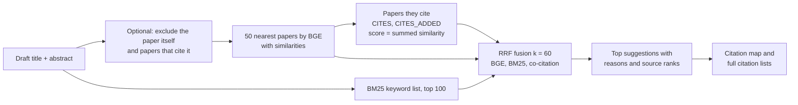

# Feature 4: Related Work (citation recommendation with co-citation)

> New to the project? Read [00_SYSTEM_OVERVIEW.md](00_SYSTEM_OVERVIEW.md) first. It explains the data, the shared components and how this feature fits with the other three.

**What it does:** you paste a draft title and abstract (or a topic), and it recommends papers you should cite, each with the reason it was chosen. It also draws an interactive **citation map** and lists every citation behind each suggestion.

**Key idea (co-citation through neighbours):** the papers most similar to your draft have already done the citing work. If many of your 50 nearest papers cite paper X, you probably should cite X too, even when X's own text does not look like your draft. This signal is fused with ordinary text retrieval.

**Where the code is:** [src/pipeline/related_work.py](../../src/pipeline/related_work.py) (`related_work`, `cocitation`, `fuse`, `citation_graph`, `attach_citation_evidence`), [app/graph_view.py](../../app/graph_view.py) (citation map), [src/evaluation/citation_recommendation.py](../../src/evaluation/citation_recommendation.py) and [src/evaluation/citeomatic_benchmark.py](../../src/evaluation/citeomatic_benchmark.py) (evaluation). UI: "Related Work" page.

---

## 1. Pipeline at a glance



Neural steps: BGE neighbours, BM25 ranking. Symbolic steps: following citation edges, the co-citation score, the exclusion rules, the fusion rule, the evidence lists.

---

## 2. Step by step

### Step 1: Input and leakage control

- Input: free text (typically the draft's title and abstract). It is encoded as a query with the BGE instruction prefix.
- If the draft is a paper already in the corpus (`paper_id` given), that paper and **every paper that cites it** are excluded from both neighbours and suggestions. Otherwise the system could "recommend" papers using the draft's own future citers, which is leakage.
- Optional `max_year`: only papers up to that year are used.

### Step 2: Nearest neighbours (BGE)

The 50 papers most similar to the input are retrieved from Chroma (`NEIGHBOURS = 50`), each with its cosine similarity $\text{sim}(q, n)$. This list is also the **BGE ranking** used later in fusion.

### Step 3: Co-citation score

For every paper $c$ cited (via `CITES` or `CITES_ADDED`) by at least one neighbour, the graph score is the summed similarity of the neighbours that cite it:

$$g(c) = \sum_{n \,\in\, N_{50}(q),\; n \rightarrow c} \text{sim}(q, n)$$

So a paper cited by many close neighbours scores highest; one cited by a single distant neighbour scores low. Papers are ranked by $g$ (ties by ID), and the list of neighbours citing each $c$ is kept as evidence (`citers`).

This is the classic co-citation idea [Small 1973], used for citation recommendation by Strohman et al. (SIGIR 2007) and by Citeomatic's NNSelect step (NAACL 2018). We do not claim the method as new; our contribution is showing it still helps modern encoders (Section 4).

### Step 4: BM25 list

BM25 over all titles and abstracts returns the top 100 papers for the input text (same BM25 as in the review mode).

### Step 5: Reciprocal rank fusion

The three ranked lists (BGE neighbours, BM25 top 100, co-citation top 100) are fused (`fuse`):

$$S(d) = \frac{w_{\text{bge}}}{60 + r_{\text{bge}}(d)} + \frac{w_{\text{bm25}}}{60 + r_{\text{bm25}}(d)} + \frac{w_{\text{cocit}}}{60 + r_{\text{cocit}}(d)}, \qquad w = 1.0 \text{ for all three}$$

A paper missing from a list gets nothing from it. Excluded papers are skipped. The top `top_k` (default 10) papers by $S$ are the suggestions, each with its per-source ranks.

**Where the settings came from:** on 200 development papers, a predeclared grid of neighbour count $k \in \{10, 20, 50\}$ and graph weight $\in \{0.5, 1.0\}$ was searched by Recall@20; $k = 50$, weight 1.0 won. It was then run once on the 400 test papers and reused unchanged on DBLP and PubMed.

### Step 6: Explanation for each suggestion

Each suggestion gets a "why" line built from its source ranks, for example:

```
cited by 7 of the 50 most similar papers; semantic match #3; keyword match #12
```

(illustrative numbers), plus:

- `cited_by_similar`: every similar paper whose reference list includes it (title and year, most similar first). This is the co-citation evidence.
- `cites` / `cited_by`: citation links between the suggestions themselves.

### Step 7: Citation map

`citation_graph` builds the drawing; `app/graph_view.py` renders it with vis-network (bundled in `app/static/`, so it works offline):

| Element | Meaning |
|---|---|
| Star node | your query / draft |
| Numbered nodes (numbers match the list) | suggestions; orange if co-citation backs them, blue if they came from text match only |
| Grey nodes | the similar papers whose citations provide the evidence (up to 12, those citing the most suggestions) |
| Dashed edge query → suggestion | text match (BGE or BM25) |
| Arrow neighbour → suggestion | that similar paper cites the suggestion (co-citation evidence) |
| Arrow suggestion → suggestion | one suggestion cites another |

Below the map, an "All citations used" section lists every citing paper behind each suggestion.

---

## 3. Worked toy example (illustrative)

Suppose three neighbours with similarities 0.82, 0.80 and 0.71 cite paper X, and one neighbour with similarity 0.69 cites paper Y:

- $g(X) = 0.82 + 0.80 + 0.71 = 2.33$, $g(Y) = 0.69$, so X ranks above Y in the co-citation list.
- If X is co-citation rank 1, BGE rank 30 and absent from BM25: $S(X) = \frac{1}{61} + \frac{1}{90} \approx 0.0275$.
- If Y is BGE rank 2 and BM25 rank 4 but co-citation rank 40: $S(Y) = \frac{1}{62} + \frac{1}{64} + \frac{1}{100} \approx 0.0417$.

Y still ranks above X here because it is strong in two text lists. Co-citation lifts X above papers that are only moderate in text, which is how it adds papers text retrieval would miss.

---

## 4. How well it works

### Our corpus (400 test papers; ground truth = each paper's real reference list, no LLM judge)

Leakage controls: the query paper's own citation edges are never used, papers citing it are excluded from the neighbours, and only papers published no later than the query are ranked.

| Method | Recall@20 | NDCG@10 | MAP |
|---|---:|---:|---:|
| **BGE + BM25 + co-citation** | **0.308** | **0.283** | **0.188** |
| Co-citation alone | 0.267 | 0.250 | 0.159 |
| BGE | 0.251 | 0.231 | 0.142 |
| BGE + BM25 | 0.241 | 0.217 | 0.135 |
| BM25 | 0.169 | 0.155 | 0.091 |

Co-citation adds **+0.068 Recall@20** over BGE + BM25 (95% CI [0.055, 0.081], p < 0.0001), a **28% relative gain**. This is the clearest place where the graph helps in the whole project.

$$\text{Recall@20} = \frac{|\text{top 20} \cap \text{true references}|}{|\text{true references}|}$$

### Public benchmarks: DBLP and PubMed (Citeomatic protocol, no training on either dataset)

| Test split | DBLP F1@20 / MRR | PubMed F1@20 / MRR |
|---|---|---|
| BGE + BM25 | 0.230 / 0.649 | 0.290 / **0.747** |
| BGE + BM25 + co-citation | 0.284 / 0.677 | 0.305 / 0.699 |
| SPECTER2 + BM25 + co-citation | **0.300 / 0.708** | **0.316** / 0.724 |
| Citeomatic, best published (trained) | 0.303 / 0.689 | 0.329 / 0.771 |

$$\text{F1@20} = \frac{2\,P@20 \cdot R@20}{P@20 + R@20}, \qquad \text{MRR} = \frac{1}{|Q|}\sum_{q} \frac{1}{\text{rank of first correct paper}}$$

- On DBLP (computer science), co-citation adds +0.069 to +0.081 Recall@20 on top of **every** encoder tried, including the citation-trained SPECTER2 and SciNCL (p < 0.001). With SPECTER2 it comes close to the trained Citeomatic system.
- On PubMed (biomedicine) it still raises recall but lowers MRR: text alone puts a correct paper first 71% of the time there, against 45% for co-citation alone, so equal-weight fusion displaces good first picks. On DBLP both are right about 52% of the time.
- Caveat: SPECTER2 and SciNCL were pretrained on citation links that probably include many of these papers.

---

## 5. Parameters

| Setting | Value |
|---|---|
| `NEIGHBOURS` | 50 |
| `GRAPH_WEIGHT` (co-citation) | 1.0 |
| `RRF_K` | 60 |
| BM25 and co-citation list depth | 100 |
| Citation edges | `CITES`, `CITES_ADDED` |
| Suggestions shown | top_k (default 10) |
| Neighbours drawn on the map | up to 12 |

## 6. Limitations

- Only papers inside the 47,619-paper corpus can be suggested.
- Co-citation favours widely cited papers (about twice as many citations as a typical correct answer), which can push aside very recent or niche papers.
- In biomedicine a lower graph weight would probably work better; the weight was kept fixed to avoid tuning on test data.
- The app encodes the input as a query, while the evaluation used stored document vectors; this is a small difference from the evaluated setting.

## 7. Try it

Mode: **Related Work**. Paste a draft title and abstract, or a topic (see [docs/DEMO_QUERIES.md](../DEMO_QUERIES.md)).
